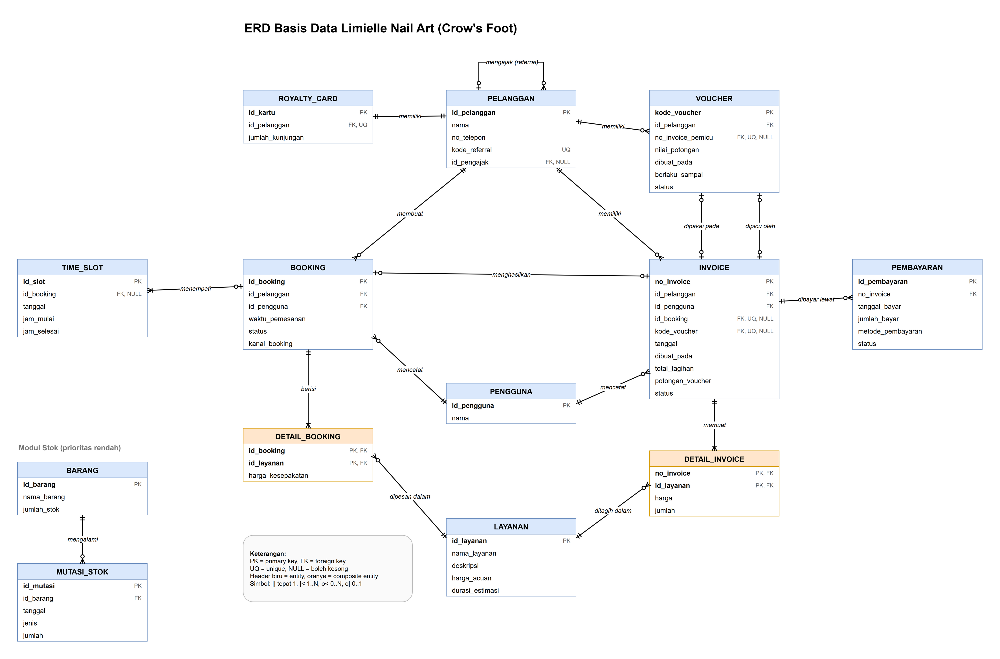

# Basis Data Limielle Nail Art

Project CE613 Database System 2026/2027 — FTEK UKSW, **Kelompok 1**.

Basis data PostgreSQL untuk **Limielle**, usaha jasa nail art milik Ci Dessy. Basis data ini mengelola pelanggan, layanan, booking dengan time slot 30 menit, invoice, pembayaran, voucher referral, royalty card, dan stok. Business rule dijaga langsung di basis data lewat constraint dan trigger.

| Nama | NIM | Peran |
|---|---|---|
| Salomo Putra Glorious Hokoyoku | 622024022 | Team Lead |
| Nabila Puspa Annastasya | 622024008 | Fullstack Developer |
| Grace | 622024010 | Fullstack Developer |

## Progress

| Tahap | Isi | Status |
|---|---|---|
| 1. Wawancara & business rule | 59 business rule (58 terkonfirmasi, 1 menunggu konfirmasi) | ✅ Selesai |
| 2. ERD | 13 entitas, notasi Crow's Foot (draw.io) | ✅ Selesai |
| 3. Tabel | 13 tabel beserta primary key, foreign key, dan constraint | ✅ Selesai |
| 4. Trigger | 18 trigger (15 trigger function) dan 5 function pendukung | ✅ Selesai |
| 5. View | Tampilan laporan dan daftar slot kosong | ⏳ Berikutnya |
| 6. Data dummy | Data contoh untuk mencoba alur | ⏳ Berikutnya |
| 7. Pengujian | Uji setiap business rule | ⏳ Berikutnya |

## Struktur Repository

```
├── database/
│   ├── 01_skema.sql             13 tabel, PK, FK, constraint
│   ├── 02_fungsi_trigger.sql    18 trigger + 5 function pendukung
│   └── gambar/                  tangkapan layar pgAdmin
├── Materi/
│   ├── Company Profile/         link website Limielle
│   ├── Developers Profile/      anggota tim
│   ├── Documents/
│   │   ├── ERD/                 ERD (.drawio dan .png)
│   │   └── Wawancara_Business/  hasil wawancara dan business rule (.docx)
│   └── Dokumentasi/             foto hasil karya Limielle
└── Presentasi/
    ├── Alur_Status_Booking.drawio
    └── link ppt.txt
```

## ERD



## Cara Menjalankan

**Lewat pgAdmin 4**

1. Buat database baru bernama `limielle`.
2. Buka **Query Tool** pada database `limielle`.
3. Buka dan jalankan (F5) `database/01_skema.sql`, lalu `database/02_fungsi_trigger.sql`.

**Lewat psql**

```sh
psql -U postgres -c "CREATE DATABASE limielle;"
cd database
psql -U postgres -d limielle -f 01_skema.sql
psql -U postgres -d limielle -f 02_fungsi_trigger.sql
```

Semua objek dibuat di schema `limielle`. Hasilnya di pgAdmin: **Tables (13)**, **Trigger Functions (15)**, dan **Functions (5)**. Ada 18 trigger tetapi hanya 15 trigger function karena `fn_larang_hapus()` dipakai bersama oleh 4 trigger larangan hapus. Trigger-nya dapat dilihat di setiap tabel → *Triggers*.

## Contoh Aturan yang Dijaga Trigger

- Booking baru berstatus *Menunggu Konfirmasi* (Limielle tidak memakai DP); status tidak bisa dilompati.
- Booking yang dibatalkan otomatis melepas slot jadwalnya.
- Booking yang *Selesai* otomatis menghasilkan invoice dengan harga kesepakatan.
- Invoice otomatis *Lunas* saat total pembayaran sama dengan tagihan; pembayaran tidak boleh melebihi tagihan.
- Invoice lunas menambah kunjungan royalty card dan memberi voucher 10% kepada pengajak (transaksi > Rp100.000).
- Data booking, invoice, dan pembayaran tidak boleh dihapus; pembatalan lewat status.

Teknologi: PostgreSQL 18, pgAdmin 4, draw.io.
